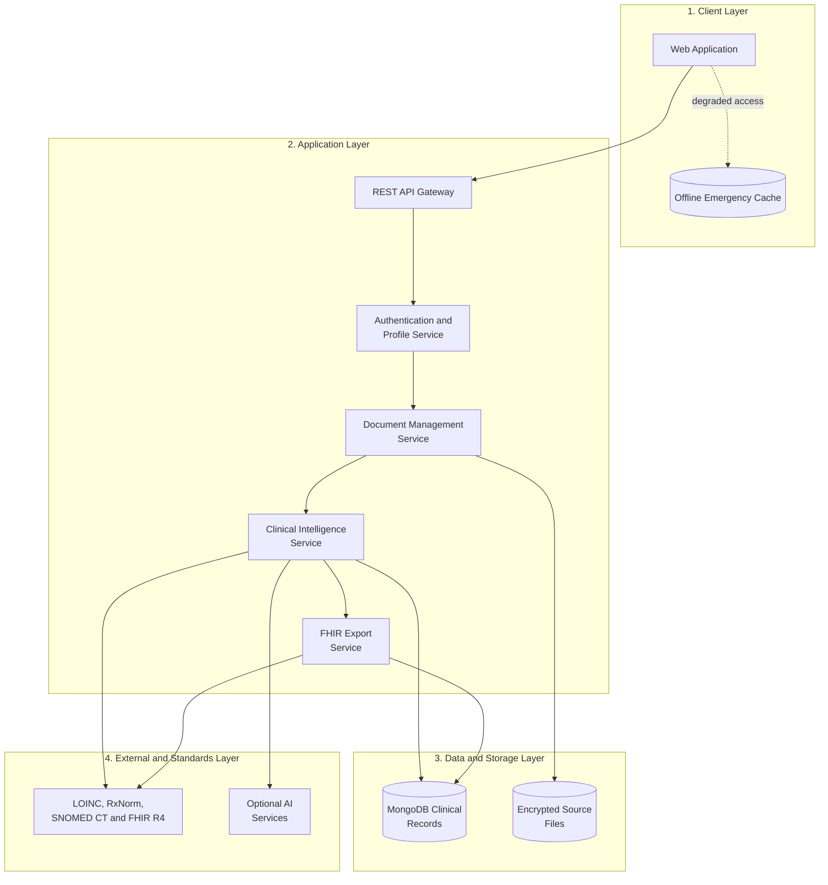

# System Architecture Diagram

## MediSage Clinical Document Intelligence Platform

## Explanation

MediSage uses a layered architecture that separates the user interface, application
services, persistent storage, and external standards or optional integrations.

- **Client layer:** The web application provides document browsing, search, clinical
  summaries, safety information, family profiles, and the emergency pass. The
  offline cache stores only the minimum information required for degraded or
  emergency access.
- **Application layer:** The REST API gateway routes requests to authentication,
  document management, clinical intelligence, and FHIR export services. Authentication
  and profile management enforce separation between patients and dependent profiles.
- **Data and storage layer:** MongoDB stores structured records and extracted clinical
  entities. Encrypted source-file storage retains uploaded prescriptions, laboratory
  reports, radiology reports, and discharge summaries separately from structured data.
- **External and standards layer:** Clinical intelligence uses standards such as LOINC,
  RxNorm, and SNOMED CT to normalize extracted information. FHIR export produces
  interoperable HL7 FHIR R4 records. Optional AI services can provide summaries and
  conversational assistance, while deterministic rules remain available as a fallback.

The main flow is from the client through the API gateway to the appropriate service.
Document and clinical-intelligence services read or update the structured database and
source files, while standards and optional AI services support normalization,
interoperability, and enhanced assistance.
